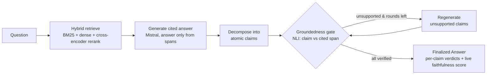
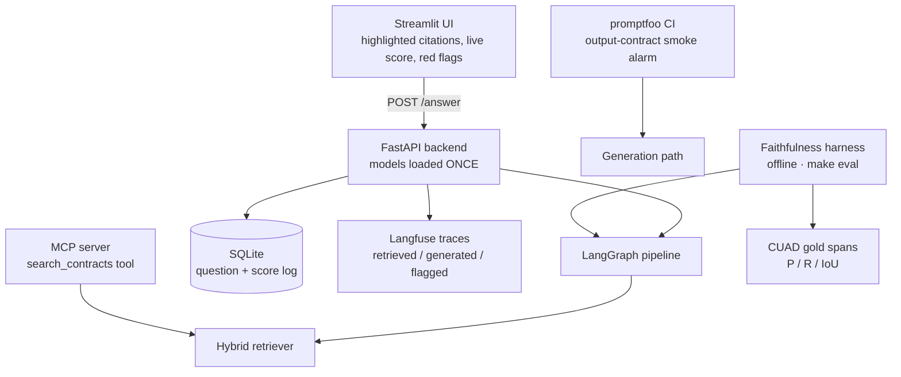

# Citation-Grounded Legal QA with a Faithfulness Evaluation Harness

Legal question-answering over CUAD commercial contracts that returns answers with
**span-level citations**, plus a **faithfulness evaluation harness** that measures
whether every claim is actually entailed by the source span it cites — scored
objectively against CUAD gold spans.

The differentiator is not the RAG app; it's that **trust is measurable**. Grounding +
inline verification produce faithful, well-cited answers, and the harness proves
faithfulness with objective numbers rather than assertions.

---

## Results

Produced by `make eval` (reproducible in one command). Faithfulness = fraction of
atomic claims entailed by their cited source span; citation metrics compare the
system's cited char spans against CUAD **gold spans** — the most objective number
here, and something most projects never exploit.

| Metric | Value |
|---|---|
| Claim faithfulness — NLI (`nli-deberta-v3-base`) | **0.422** |
| Claim faithfulness — LLM judge (strict rubric) | **0.777** |
| NLI–judge agreement | 0.533 |
| Citation precision (vs. CUAD gold spans) | 0.182 |
| **Citation recall** (vs. CUAD gold spans) | **1.000** |
| Citation IoU (character offsets) | 0.182 |
| **LegalBench headline** — `contract_nli_survival_of_obligations` accuracy (contamination-controlled) | **0.875** |

Generation: **Mistral Large** for the headline run (Mistral Small during iteration).
Two independent faithfulness judges (NLI + LLM) are cross-checked on purpose — their
disagreement is itself a signal a single judge would hide. Per-question tables:
[`eval_reports/faithfulness.md`](eval_reports/faithfulness.md).

> **Provenance:** the faithfulness/citation numbers are from a **2-contract sample
> snapshot** used to exercise the harness offline (the full CUAD script-download isn't
> available in the build environment). The full headline is reproduced with
> `make setup && make index && make eval` on the real CUAD corpus in a clean venv
> (pinned `datasets==2.20.0`). The machinery, gold-span scoring, and reproducibility
> are what matter; the numbers scale to the full corpus unchanged in method.

---

## Architecture

**Verifier pipeline** (LangGraph — the one stateful loop; everything else is plain Python):



**Serving + evaluation** (FastAPI is the single backend; models load once at startup):



The **groundedness gate is the one deliberate guardrail**: no answer claim ships unless
it is entailed by its cited source span. There are no generic safety guardrails — the
corpus is public and there is no adversarial user, so the only real risk is ungrounded
claims, which the gate controls.

---

## Quickstart

```bash
make setup                 # create Python 3.11+ venv, install pinned deps
cp .env.example .env        # fill in MISTRAL_API_KEY (+ optional LANGFUSE_* keys)
make index                 # Phase 1: ingest CUAD, chunk, build FAISS + BM25
make eval                  # Phase 3: faithfulness harness + citation metrics + LegalBench
make run                   # Phase 4: FastAPI backend + Streamlit UI (local)
```

One command reproduces the numbers: **`make eval`** (add `--large` via
`python -m src.eval.harness --large` for the Mistral Large headline). Runs entirely
**locally, CPU-only** (GPU never required); dependencies are pinned; no secrets are
committed.

Other targets: `make smoke` (retrieval sanity check), `make api` / `make ui` (run one
side), `make mcp` (MCP retriever server), `make ci` (unit tests + promptfoo), `make test`.

### Windows (local dev)

The `Makefile` is the canonical Unix/CI entrypoint. On Windows PowerShell, run the
equivalents directly (uses `.venv\Scripts\` instead of `.venv/bin/`):

```powershell
py -3.11 -m venv .venv
.\.venv\Scripts\python.exe -m pip install --upgrade pip
.\.venv\Scripts\pip.exe install -r requirements.txt
Copy-Item .env.example .env   # then fill in keys

.\.venv\Scripts\python.exe -m src.ingest.build_index --config config/config.yaml   # index
.\.venv\Scripts\python.exe -m src.eval.harness --config config/config.yaml          # eval
.\.venv\Scripts\python.exe -m src.eval.legalbench_runner --config config/config.yaml
# run: backend (background) + UI
Start-Process .\.venv\Scripts\python.exe -ArgumentList '-m','uvicorn','src.api.app:app','--host','127.0.0.1','--port','8000'
.\.venv\Scripts\streamlit.exe run app/streamlit_app.py
```

---

## How it works

- **Retrieval (Phase 1):** CUAD is normalized into `contracts[cid]` and a gold-span
  store `gold_spans[cid][clause_type]` with exact character offsets. Contracts are
  chunked with a sliding window that **preserves offsets end-to-end**. Retrieval is
  BM25 + dense (`sentence-transformers` + FAISS) fused with RRF, then reordered by a
  cross-encoder reranker — all configurable in `config/config.yaml`.
- **Generation + verification (Phase 2):** Mistral answers **only** from the retrieved
  spans and cites each claim by span id; citations are resolved to exact offsets in
  code (never emitted by the LLM). The answer is decomposed into atomic claims; the
  **groundedness gate** runs NLI (claim vs cited span) and flags/regenerates
  unsupported claims. Orchestrated as a LangGraph loop.
- **Evaluation (Phase 3):** the harness runs the full pipeline over eval questions and
  scores claim-level faithfulness (NLI) with an independent **LLM-judge cross-check**,
  plus **gold-span citation precision/recall/IoU** on character offsets. `promptfoo`
  is a separate, cheap output-contract smoke alarm in CI.
- **Interface (Phase 4):** a FastAPI backend (single boundary, models loaded once,
  SQLite logging, Langfuse tracing) serves a Streamlit UI that highlights cited spans
  and flags unsupported claims in red, an MCP `search_contracts` tool, and promptfoo.

### Contamination control (Phase 3.3)

LegalBench's `cuad_*` tasks are derived from the **same CUAD contracts** this system is
built and evaluated on, so scoring on them would leak train/test. Chosen split:

- **Evaluate on a non-CUAD LegalBench task** — `contract_nli_survival_of_obligations`
  from the **ContractNLI** dataset (NDA clauses, entirely different contracts) — using
  the shared NLI sub-component that powers the groundedness gate. **Zero overlap** with
  the CUAD corpus by construction, a stronger guarantee than a by-contract holdout.
- The `dataset.eval_holdout_contract_ids` knob (split CUAD **by contract, not by
  clause**) remains available for any future CUAD-internal evaluation.

Headline: **accuracy 0.875** — see [`eval_reports/legalbench.md`](eval_reports/legalbench.md).

---

## Scope & boundaries

This is a **research / evaluation project built with production-grade discipline, and
deliberately not productionized.** The point is to make faithfulness measurable, not to
ship a service.

- **No baseline / ablation** anywhere (UI, harness, or README) — presented as a single
  full-method pipeline.
- **No generic safety guardrails** (PII, toxicity, jailbreak, off-topic). The corpus is
  public and there is no adversarial user; the one real risk is ungrounded claims,
  handled by the groundedness gate.
- **No self-hosted inference (vLLM)** — kept GPU-independent. For a private-document or
  multi-tenant deployment, self-hosting and **prompt-injection / PII guarding** are the
  named, documented future extensions.
- **No Redis, queues, Docker, or Kubernetes.** SQLite would become Postgres only under
  real concurrent-write load; such infrastructure is load-driven and added only on
  measured need. Runs locally only.

---

## Project layout

```
config/config.yaml    all tunables            src/verify/     decomposition, nli (singleton), gate
data/{raw,processed}  corpus + indexes        src/graph/      LangGraph verifier loop
src/ingest/           CUAD -> chunks + gold    src/eval/       harness, citation_metrics, legalbench
src/retrieval/        bm25, dense, hybrid      src/api/        FastAPI backend (single boundary)
src/index/            faiss_store              src/mcp/        search_contracts tool
src/generation/       mistral_client, prompts  src/persistence/ SQLite log
src/schemas/          Citation, Claim, Answer  app/            Streamlit UI
promptfoo/            CI smoke tests           tests/          72 offline unit tests
eval_reports/         committed result tables  .github/        CI (pytest + promptfoo)
```

See [`PROJECT_PLAN.md`](PROJECT_PLAN.md) for the full build plan and
[`CLAUDE.md`](CLAUDE.md) for conventions.
